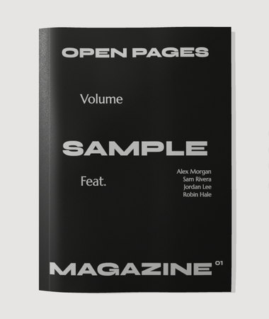

# Magazine Web

A template for publishing an independent, design-magazine-style issue on the web — as a book you can actually flip through.

Each piece in the magazine (an essay, an interview, a photo series, a poem…) takes a double-page spread with its own layout and colors. Everything is edited from a small admin panel: no code needed once it's deployed.

<p align="center"></p>

Built with [Next.js](https://nextjs.org) 15, [leafthrough](https://www.npmjs.com/package/leafthrough) for the page-turning, Postgres ([Neon](https://neon.tech)) and [Vercel Blob](https://vercel.com/docs/storage/vercel-blob).

## Features

- **Flip-through magazine** with realistic page turns, on desktop (spreads) and mobile (single pages).
- **Typographic cover** generated from your settings: masthead, tagline, headline, issue number and a "Feat." list of contributors.
- **Choose what goes on each page**: text or photo on the left, text or photo on the right — plus special layouts for interviews, openers and poems.
- **Colors per spread**: give any piece its own page and text color, or use the magazine's palette.
- **Admin panel** with a live preview of each spread while you type.
- **Image uploads** straight from the browser, resized and converted to WebP before uploading.
- **Works without a database**: locally, pieces are read from Markdown files, so you can try it in a minute.
- Front matter pages (title page, copyright, dedication, epigraph, contents) built automatically.
- **A URL for every piece** (`/your-piece`): opens the magazine at that spread, and the address follows along as you flip, so sharing a link shares what you're reading.
- **Search-engine friendly**: per-piece titles, descriptions and link-preview images, the full text in the HTML (the pages themselves are a canvas), structured data (schema.org) and a sitemap.
- **Reader tools**: arrows and a page counter, keyboard navigation (←/→, Page Up/Down, Home/End), a visual table of contents with thumbnails, a "Read as text" view and a zoom view (double-click the pages).
- **Editor helpers**: a space meter that warns before text gets cut, contrast warnings, saved color palettes, drag-and-drop ordering, duplicate a piece, full-screen preview, and a preview of the whole issue including drafts.
- **Font pairings** to choose from in the admin, and a back cover with its own colors and text.
- Share buttons (copy link, WhatsApp, native share) and a sign-in icon for the admin.

## Quick start

You need [Node.js](https://nodejs.org) 18.18 or newer.

```bash
git clone https://github.com/<your-username>/magazine-web.git
cd magazine-web
npm install
npm run dev
```

Open http://localhost:3000. You'll see the sample issue, read from the Markdown files in `content/pieces/`.

To use the admin panel locally, copy the example environment file and set a password:

```bash
cp .env.example .env.local
```

```bash
# .env.local
ADMIN_PASSWORD=choose-a-password
```

Then restart `npm run dev` and open http://localhost:3000/admin (or click the sign-in icon next to the share buttons). Saving changes from the panel needs a database (see [Deploying](#deploying-on-vercel)).

## Writing pieces

There are two ways to add content:

1. **From the admin panel** (`/admin`, needs a database): pick a layout, write, upload images, choose colors and watch the preview.
2. **As Markdown files** in `content/pieces/`: handy for trying the template or keeping content in git. They're shown when there's no database, and imported into the database the first time it's connected.

A Markdown piece looks like this:

```markdown
---
title: Notes on\nQuiet\nArchitecture
layout: essay
credit: Alex Morgan
label: Essay
location: City, Country
illustration: my-photo.jpg
illustration2:
background: #ffe600
ink: #1c1b1a
---
The body goes here. Paragraphs are separated by a blank line.

## A subhead

More text.
```

| Field | What it does |
| --- | --- |
| `title` | The piece's title. Use `\n` to choose where a big title breaks. |
| `layout` | `text-photo`, `photo-text`, `photo`, `essay`, `spread`, `gallery`, `quote`, `interview`, `opener` or `poem` (see below). |
| `credit` | Who wrote it or who is featured. Shown on the spread and in the cover's "Feat." list. |
| `label` | Section label at the top of the page. Defaults to the layout's name. |
| `location` | Small caption, e.g. "Tokyo, Japan". |
| `illustration` … `illustration4` | Image file names in `public/illustrations/`, or full URLs. Without an image, a placeholder frame is shown. |
| `background`, `ink` | Page and text colors for this spread, as `#rrggbb`. Leave empty to use the magazine's colors. |

Files are ordered by name, so prefix them with numbers (`01-…`, `02-…`).

## Layouts

Every piece takes exactly one double-page spread. In the admin panel you choose what goes on each page — **Left: Text or Photo**, **Right: Text or Photo** — or pick one of the special layouts:

| Layout | Left page | Right page | Body text |
| --- | --- | --- | --- |
| `text-photo` | label, big title, credit and text | image, cropped to fill | paragraphs; `## ` for subheads |
| `photo-text` | image, cropped to fill | label, big title, credit and text | paragraphs; `## ` for subheads |
| `essay` | section label, vertical "Text by", huge title | text in two columns | paragraphs; start a line with `## ` for a subhead |
| `interview` | Q&A in two columns, vertical "with" | image, cropped to fill | paragraphs starting with `Q:` and `A:` |
| `opener` | big page number, name, title, location | image, cropped to fill | not shown |
| `photo` | image and caption | second image | not shown |
| `poem` | image (whole, not cropped) or page number | title and poem | one line per verse, blank line between stanzas |
| `spread` | one image across both pages | (same image) | not shown; title and location are the caption |
| `gallery` | two images | two images | not shown; title and location are the caption |
| `quote` | a giant quotation mark | the quote, set large, and the credit | the quote |

Text that doesn't fit on its spread is cut at the end of the last column. The editor shows a space meter under the text and tells you how many words won't fit, so you can shorten it or split the piece in two.

## Design settings

In `/admin/book` ("Magazine & design") you can set:

- **Cover**: masthead (the magazine's name), issue number, tagline and headline.
- **Colors**: cover, cover text, pages, page text, back cover, back cover text and the background behind the magazine (with a warning when text and background contrast too little).
- **Back cover**: a short closing text.
- **Fonts**: one of four pairings (Editorial, Classic, Modern, Grotesk).
- **Saved palettes**: color pairs offered as one-click chips on every piece (you can also save one from a piece).
- **Credits**: editor, year, image credits and rights line.
- **Dedication and epigraph**: each can be shown or hidden.

The defaults live in `lib/bookData.ts`.

### Fonts

All fonts are free and loaded from Google Fonts in `app/layout.tsx`. The default pairing (Editorial) is:

| Variable | Font | Used for |
| --- | --- | --- |
| `--display` | Marcellus | big titles, page numbers |
| `--sans` | Syne | cover masthead, section labels |
| `--serif` | Newsreader | body text |

The other pairings are chosen in **Magazine & design**; only the chosen one is downloaded. To add your own, load the fonts in `app/layout.tsx` with `preload: false`, add an entry to `THEMES` there and to `FONT_THEMES` in `lib/layouts.ts`.

### Page size and drawing

Pages are drawn on a canvas in `components/Book.tsx` at 1000 × 1320 px. Each layout is a `case` in `piecePages()`, so adding a new layout means adding a key to `LAYOUTS` in `lib/layouts.ts` and a `case` in that function.

## Search engines and link previews

The pages are drawn on a canvas, which search engines can't read, so every URL also carries the same content as plain HTML (visually hidden, available to crawlers and screen readers):

- `/` — the magazine's name, issue and a linked table of contents.
- `/<slug>` — the piece's title, credit and full text, plus links to every other piece.

Each URL gets its own `<title>`, description, canonical link and an Open Graph image generated in the magazine's colors (`app/opengraph-image.tsx`, `app/[slug]/opengraph-image.tsx`). `sitemap.xml` lists every published piece and `robots.txt` keeps `/admin` out of search results.

Set `NEXT_PUBLIC_SITE_URL` to your domain (e.g. `https://example.com`) so canonical links and the sitemap use it. On Vercel the production URL is used automatically.

The favicon is `app/icon.svg` and the home-screen icon `app/apple-icon.png`.

## Deploying on Vercel

There are no user accounts: the admin panel uses a single password. Everything else is configured in your Vercel project:

| What | Where in Vercel | Variable |
| --- | --- | --- |
| Admin login | Settings → Environment Variables | `ADMIN_PASSWORD` (and optionally a long random `ADMIN_SECRET`) |
| Pieces and settings | Storage → Create Database → **Neon** (Postgres) | `DATABASE_URL` (created for you) |
| Image uploads | Storage → Create → **Blob** | `BLOB_READ_WRITE_TOKEN` (created for you) |

Steps:

1. Push your copy of the repository to GitHub and import it in Vercel.
2. In the **Storage** tab, create a Neon database and a Blob store and connect both to the project.
3. In **Settings → Environment Variables**, add `ADMIN_PASSWORD`.
4. Redeploy so the new variables are picked up.
5. Open `/admin` on your site and log in.

On the first request the tables are created automatically and the sample pieces in `content/pieces/` are imported. Delete them from the admin panel when you start your own issue.

To work locally against the same database and storage, put the same values in `.env.local`, or pull them with the Vercel CLI:

```bash
vercel env pull .env.local
```

### Environment variables

| Variable | Required | Purpose |
| --- | --- | --- |
| `ADMIN_PASSWORD` | for the admin | Password for `/admin` |
| `ADMIN_SECRET` | no | Signs the session cookie (falls back to `ADMIN_PASSWORD`) |
| `DATABASE_URL` | for editing | Neon Postgres connection string |
| `BLOB_READ_WRITE_TOKEN` | for uploads | Vercel Blob token |
| `NEXT_PUBLIC_SITE_URL` | no | Public URL, used for metadata and the sitemap |

## Project structure

```
app/
  page.tsx              the magazine, opened at the cover
  [slug]/               one URL per piece (opens at its spread)
  opengraph-image.tsx   link-preview image
  icon.svg              favicon
  layout.tsx            fonts and metadata
  admin/                admin panel: pieces, magazine & design, login
  api/illustrations/    signed uploads to Vercel Blob
components/
  Book.tsx              draws every page on a canvas and hands them to leafthrough
  Magazine.tsx          the page around the book, with the indexable HTML version
  Share.tsx             share buttons and sign-in icon
lib/
  layouts.ts            layout list and the Piece type (shared with the browser)
  pieces.ts             pieces from the database or from content/pieces
  bookData.ts           magazine details, cover text and colors
  auth.ts               admin session (single password, signed cookie)
content/pieces/         sample pieces in Markdown
public/illustrations/   images referenced by the Markdown pieces
middleware.ts           protects /admin
```

## Troubleshooting

- **"Database missing" in the admin**: `DATABASE_URL` isn't set. The magazine still works from the Markdown files.
- **"ADMIN_PASSWORD is not set on the server"**: add the variable and restart the dev server or redeploy.
- **"Couldn't upload the image"**: `BLOB_READ_WRITE_TOKEN` is missing, or you're not signed in.
- **Fonts look like Georgia in the pages**: the page drew before the fonts loaded; reload. If you changed fonts, check the `variable` names in `app/layout.tsx`.
- **Changes in Markdown don't show up after deploying**: once a database is connected, content comes from the database, not from the files.

## Credits

- Page turning by [leafthrough](https://www.npmjs.com/package/leafthrough).
- Fonts from Google Fonts (SIL Open Font License): Marcellus, Syne, Newsreader, Playfair Display, Inter, Lora, DM Serif Display, Space Grotesk, Source Serif 4, Archivo, Archivo Black and IBM Plex Serif.
- Sample texts are placeholders written for this template.

## License

MIT, see [`LICENSE`](LICENSE). The license covers the code; the content you publish with it is yours.
